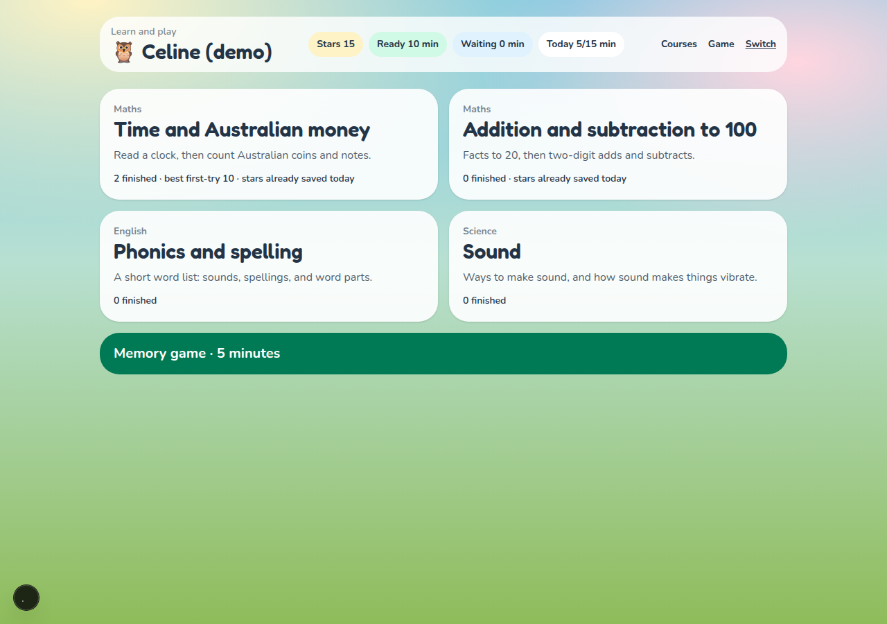
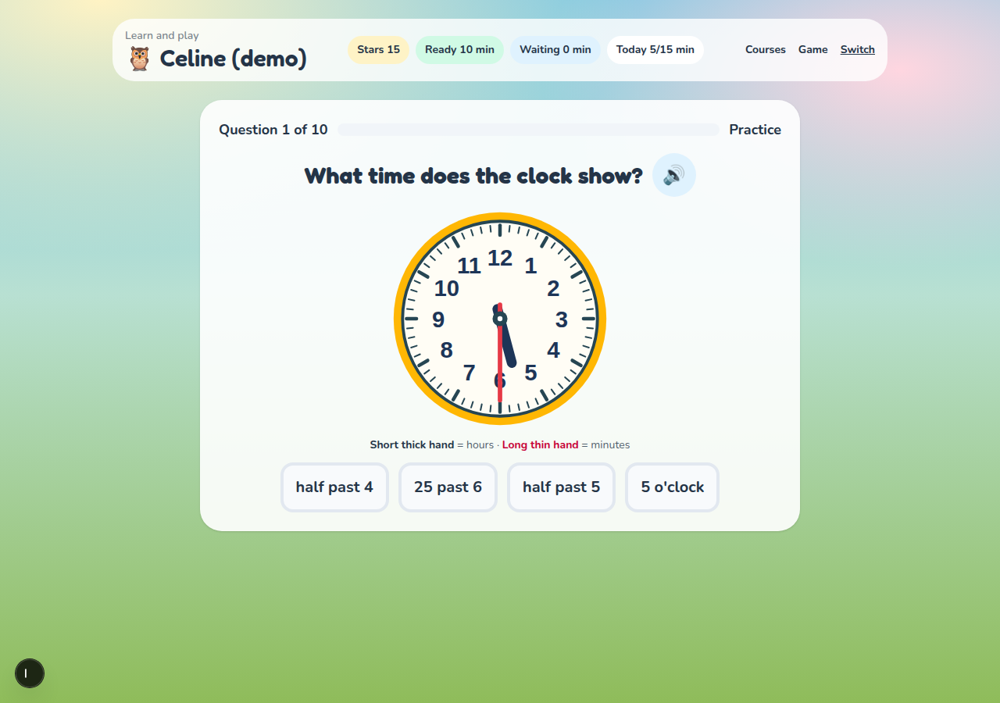
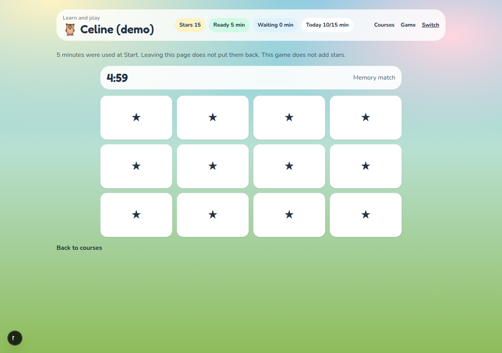
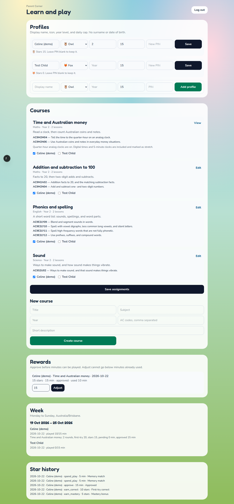

# Learn and Play (kids-gamification)

Local demo for Year 2 practice. A child picks a picture, enters a PIN, and works through a short round. A first-try correct answer adds one star. Stars become minutes only after a parent approves them. A built-in memory match spends those minutes on a timer.

This slice extends the Next.js app already on `main`. The older energy, coin, and map tables stay in the database and are not shown.

**Not for real child data.** Do not deploy this demo to the public hostname.

## Run locally

One command after install. It migrates and seeds, then starts the app:

```bash
npm install
npm run dev
```

Open http://localhost:3000

Health check:

```bash
curl -s http://localhost:3000/api/health
# → {"status":"ok"}
```

`npm run verify` runs lint, the star/minute tests, and the production build.

## Docker

The compose file publishes host port **3118** to the container port 3000. The entrypoint migrates and seeds, then starts the server.

```bash
docker compose up --build
```

Open http://127.0.0.1:3118

Do not bind this app to host port 3000 on the VPS.

## Demo logins

These are fake local logins, not real secrets. They are hashed before they are stored. `data/app.db` is gitignored.

| Who | How to sign in |
| --- | --- |
| Demo parent | Parent Corner password `demo-parent` |
| Celine (demo) | Owl picture, then PIN `2580`. Year 2. |
| Test Child | Fox picture, then PIN `1470`. No courses until a parent assigns one. |

Pictures are built-in icons. There is no photo upload, surname, school, or date of birth.

A kid session cannot open Parent Corner. The parent password is a separate gate.

## What the demo includes

- Four Year 2 courses: time and Australian money (clock plus coins and notes), addition and subtraction to 100, a short phonics list, and science sound (`AC9S2U02`).
- Quarter-hour clocks are on. Digital times and 5-minute clocks are included and marked as stretch.
- First try correct: +1 star. A later try or a revealed answer: +0. One scored round per course per local day (`Australia/Brisbane`). Mastery at 8/10 first-try correct: +5 stars.
- 1 star = 1 minute, pending until a parent approves. Daily cap 15 minutes. Approved minutes carry forward, and a day still cannot pass the cap.
- Memory match uses coins and clocks. A block is 5 minutes, deducted at Start. Leaving the page does not refund. The game does not add stars.
- Pretty stars at the end of a round are decoration. They do not enter the play-time wallet.
- Parent Corner: profiles, courses (multiple choice and number questions), assignments, week view (Monday–Sunday), star history, approve and adjust. Built-in courses show their AC codes.

## Screenshots

Kid home:



A telling-time question:



Memory match after Start:



Parent Corner:



## Stack

- Next.js 15 (App Router) + TypeScript + Tailwind
- SQLite via `better-sqlite3` + Drizzle ORM
- Local database `data/app.db`. Docker database `/data/app.db`

## Deploy notes

The learn-and-play demo stays local. The existing Coolify path is unchanged and is not used for this slice. See [`docs/COOLIFY_DEPLOYMENT.md`](docs/COOLIFY_DEPLOYMENT.md).

- Container port `3000`, persistent volume `/data` for SQLite
- Manual fallback: `docker compose up -d --build` → `127.0.0.1:3118`

## Agent harness

- [`AGENTS.md`](AGENTS.md) — agent behavior
- [`docs/agent-graph-pr.md`](docs/agent-graph-pr.md) — plan → build → independent review → human merge
- `.cursor/agents/` — verifier, security-auditor, ui-reviewer
